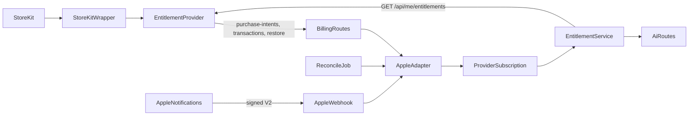

# MesoIQ Pro subscriptions — build PRD

Status: build-ready specification for an implementing agent. Product decisions come
from [`pro-subscriptions.md`](pro-subscriptions.md). This document maps those
decisions onto the current codebases and defines phases, contracts and acceptance
checks.

**Scope of this document:** iOS Apple subscriptions, backend entitlements, mobile
feature gates, and server-side AI enforcement (including a minimal web message).
It does not cover Stripe checkout or gating web analytics.

## Product decisions (carried forward)

Pro serves self-directed lifters who want to understand progress, identify stalls,
and improve their programming. Free remains useful indefinitely as a primary
workout logger.

- Launch purchases on iOS through Apple auto-renewable subscriptions.
- Offer one monthly plan with a Canadian base price of CAD $4.99 and localized
  storefront pricing. Read the displayed price from StoreKit.
- No annual plan, free trial, introductory offer, or Family Sharing at launch.
- Apply the new free/Pro gates to existing accounts immediately; no grandfathering
  or transition preview.
- Keep unlimited manual programs and cycles free.
- Pro includes the existing AI “describe a program” generation feature. Do not
  build AI quotas, credits, usage allowances, or additional AI functionality.
- Present upgrades when users select Pro features and from Settings. Do not
  interrupt logging or require an onboarding paywall.
- Locked features show a short explanation and clearly labelled example data,
  never example numbers presented as the user's actual training results.

### Feature boundary

| Feature | Free | Pro |
| --- | --- | --- |
| Workout logging, previous performance, supported set types, custom exercises | Yes | Yes |
| Manual program creation/editing and repeated training cycles | Unlimited | Unlimited |
| All session/cycle history, saved programs, data export | Yes | Yes |
| Personal records and basic per-exercise progress charts | Yes | Yes |
| Consistency calendar, streaks, adherence, ordinary cycle progress | Yes | Yes |
| Basic totals, monthly tonnage, per-exercise volume charts | Yes | Yes |
| Program-builder planned-volume bars and days-since-trained aids | Yes | Yes |
| Existing AI “describe a program” generation | No | Yes |
| Stall detection and cross-exercise strength analysis | No | Yes |
| Muscle progression, working-set/baseline analysis, rep-range breakdowns | No | Yes |
| Weight × rep matrix and detailed cycle comparisons | No | Yes |

Saved AI-generated programs remain editable and usable after Pro expires. Expiry
does not delete programs or training data. Only paid analysis and new AI
generation close. User-initiated data/account deletion remains available.

### Session decisions that amend the original spec

- **Web AI enforcement:** enforce Pro on the backend for `POST /api/plans/create-with-ai`
  and `POST /api/chat`. Show a “MesoIQ Pro required — subscribe in the iOS app”
  message at the web AI entry points. Leave web analytics ungated in this release.
- **Sandbox on production:** the production backend accepts Apple sandbox
  transactions for any account. Store them with environment `SANDBOX`, scoped
  separately from production identifiers, controlled by
  `APPLE_ACCEPT_SANDBOX=true`. This is an explicit change from the original
  “sandbox must never grant production access” rule. The risk is that TestFlight
  and App Review sandbox purchases grant Pro on the production backend without
  App Store production billing.

---

## 1. Scope, repos and how to work

### Repos

| Repo | Role | Path |
| --- | --- | --- |
| MesoIQ | React Native 0.83.1 / React 19.2 / TypeScript client; iOS minimum 15.1 | `/Users/craigjames/Repos/MesoIQ` |
| simple-workout-tracker | Next.js 15.1 / Prisma 5 / PostgreSQL API and web app; Cloud Run | `/Users/craigjames/Repos/simple-workout-tracker` |

There is no existing subscription, entitlement or StoreKit integration on `main`
in either repo.

### Branching

- One branch per phase per repo: `pro/phase-N-<slug>`.
- Prefer small PRs that match the phases in [§8 Phases](#8-phases).
- Do not merge client gates that call new endpoints before those endpoints are
  live, unless the client degrades cleanly to free when the entitlement fetch
  fails.

### Checks

**Mobile** (before each commit):

```sh
npx tsc --noEmit
npm run lint
npm test
```

**Backend** (before each commit once Phase 1 lands):

```sh
npm run lint
npm test   # Vitest — add this script in Phase 1
```

Follow redesign conventions for new mobile UI: tokens from `src/theme` only, API
calls in `src/services`, derivations in `src/analytics`, data through hooks,
`accessibilityLabel` and 44pt hit areas on icon-only controls. See
[`docs/redesign/README.md`](redesign/README.md).

### Do not reuse the old paywall branches

Treat these as reference only. Do not cherry-pick them wholesale:

| Branch | Repo | Why it conflicts |
| --- | --- | --- |
| `feature/paywall` | MesoIQ | Puts `isPro` in JWT claims; yearly + monthly product IDs; finishes StoreKit transactions without server verification; endpoints do not match this PRD |
| `feature/pay-wall` | simple-workout-tracker | No migration; unsigned Apple webhook; deprecated `verifyReceipt`; user-level `subscriptionStatus` fields instead of provider-independent entitlements; JWT `isPro` claims go stale for up to 30 days |

---

## 2. Feature boundary mapped to code

Gate sections, not entire Data, Cycle or Progress routes. Product screens consume
capabilities such as `canUseAdvancedAnalytics` and `canUseAiProgramGeneration`.
They do not inspect Apple product IDs or run their own subscription-state rules.

### Cycle tab — `src/screens/data/CycleTab.tsx`

| Section | Lines | Tier |
| --- | --- | --- |
| Hero: week/RIR label, days logged, week dots | 138–150 | Free |
| What changed insights (stall + fastest riser) | 90–120 computation; 152–157 render | Pro |
| Working sets, last 7 days + caption | 159–184 | Pro |
| Working-sets drill-down `Sheet` | 238–259 | Pro |
| Strength trend | 186–218 | Pro |
| This cycle vs. last (`Radar`) | 220–235 | Pro |

Keep the ordinary week/RIR/days-logged overview free. Wrap each Pro card in
`ProGate` / `LockedSection` so free users see a short explanation and labelled
example data.

### Progress tab — `src/screens/data/ProgressTab.tsx`

| Section | Lines | Tier |
| --- | --- | --- |
| THIS EXERCISE: picker, hero e1RM, change, `E1rmChart` | 77–116 | Free |
| RECORDS (`RecordTiles`) | 119–124 | Free |
| Where you actually train (`Matrix`) | 126–137 | Pro |
| Rep ranges | 139–161 | Pro |
| Overload rate by muscle | 163–193 | Pro |
| `ExercisePickerSheet` | 195–206 | Free |

Do not gate the shared `E1rmChart` component
(`src/components/exercise/ExerciseCharts.tsx`) or its ordinary fitted trend line.

### New program sheet — `src/components/plan/NewProgramSheet.tsx`

| Piece | Lines | Tier |
| --- | --- | --- |
| “Build it yourself” `OptionCard` | 70–75 | Free |
| “Describe it” `OptionCard`, prompt field, starter chips | 76–98 | Pro |
| `draft()` and “Draft my program” footer | 40–68 | Pro |

When the user is free and taps Describe it, do not start generation. Close the
sheet (use `Sheet`'s `onClosed`) and navigate to `Paywall` with
`source: 'ai_describe'`. Calling `POST /api/plans/create-with-ai` from a free
account must also fail with `403 pro_required` on the server.

### Aggregate cycle avg e1RM

All of these derive from `cycleE1rmDelta(...).average` via
`useMesocycleSummaries().avgE1rm` or `useCycleStats().e1rmDelta`.

| Location | Lines | Free behavior |
| --- | --- | --- |
| `src/screens/mesocycle/MesocycleDetailScreen.tsx` `StatTile "Avg e1RM"` | 139–144 | Show a locked `StatTile` that opens the paywall |
| `src/screens/main/PlanScreen.tsx` active-cycle meta | 101–106 | Omit the `DeltaText` / “est. 1RM so far” fragment |
| `src/screens/plan/ProgramsTab.tsx` `ProgramCard` | 65–70 | Omit the “last avg e1RM” fragment |
| `src/components/session/MesocycleRow.tsx` | 33–40 | Omit the right-side delta (affects `HistoryTab` and `PlanDetailScreen`) |

### Must stay free

- `E1rmChart` and records on Progress and Exercise detail
  (`src/screens/exercise/ExerciseDetailScreen.tsx`)
- Per-exercise completion records on
  `src/screens/workout/WorkoutCompleteScreen.tsx`
- `src/screens/main/TrackScreen.tsx` (no aggregate strength today)
- History tab content other than the avg e1RM delta on mesocycle rows
- Consistency / heatmap, export, manual program create/edit, cycles, logging

### Account settings — `src/screens/main/AccountSettingsScreen.tsx`

Current layout: profile card (80–92), DATA export (94–102), ACCOUNT sign out /
delete (104–110), optional Style guide (112–116), version footer (118).

Add:

- **SUBSCRIPTION** group: Upgrade (when not entitled), status row (renewable /
  cancelled-but-active / grace / expired with dates), Manage subscription per
  Apple source, Restore Purchases.
- **LEGAL** group: Privacy Policy and Terms of Service (shared URLs).
- Update the delete alert (36–62) to warn that deleting MesoIQ does not cancel
  Apple billing, offer Manage Subscription, and still allow deletion without
  prior cancellation.

### Chart info copy

Pro section info IDs in `src/components/ui/chartInfo.ts`: `hardSets`,
`strengthTrend`, `cycleRadar`, `weightRepMatrix`, `repRanges`, `overload`. Keep
those info sheets available behind the gate (or from the locked preview) so
locked users can still learn what the chart measures.

---

## 3. Architecture



### Ownership rules

- MesoIQ Pro belongs to a MesoIQ account. Apple (and later Stripe) are billing
  sources that grant the same internal `pro` plan.
- Provider adapters verify evidence and update provider records. A central
  entitlement service computes capabilities and purchase eligibility.
- Do not grant access from an unverified transaction, client boolean, or pending
  purchase.
- Turning off renewal does not remove access during the paid period.
- Expiring, refunding or revoking one source cannot remove access granted by
  another valid source. Recompute across all eligible sources.
- Screens never inspect product IDs. They read `capabilities` from the
  entitlement owner.

### Internal plan

Stable internal plan id: `pro`.

Capabilities:

- `advanced_analytics`
- `ai_program_generation`

Map Apple product id (from env, default `com.mesoiq.pro.monthly`) → `pro` on the
server. Clients never hardcode that mapping for gating.

---

## 4. Backend specification (`simple-workout-tracker`)

### 4.1 Prerequisites (Phase 1)

Do these before shipping billing code to production:

1. **Node 22.** The App Store Server Library for Node currently requires Node 22+.
   Change `Dockerfile` base images from `node:18-alpine` / `node:18-slim` to
   Node 22 equivalents. Confirm Cloud Run runtime matches.
2. **Vitest.** The repo has no test runner. Add Vitest, a `test` script, and a
   Postgres test database (docker-compose service or dedicated `DATABASE_URL` for
   tests). Prefer testing pure entitlement math and adapter mapping without a DB
   where possible; use the DB for uniqueness and race tests.
3. **Env schema.** Add `.env.example` and `src/lib/env.ts` (zod). Validate at
   boot for billing-related keys. Today the code reads `process.env` ad hoc and
   `.env.example` is missing despite the README referring to it.
4. **Deploy workflow.** [`.github/workflows/deploy-gcp.yml`](../../simple-workout-tracker/.github/workflows/deploy-gcp.yml)
   uses repeated `--set-env-vars`, which replaces the service’s env on every
   deploy. `OPENAI_API_KEY` is not in the list. Move secrets to Cloud Run secrets
   (`--set-secrets` / `--update-secrets`) and keep non-secrets with
   `--update-env-vars` so existing keys are not wiped. Add Apple keys:
   - `APPLE_BUNDLE_ID` = `com.meso-iq.meso-iq-tracker`
   - `APPLE_APP_APPLE_ID` (numeric App Store app id)
   - `APPLE_ISSUER_ID`, `APPLE_KEY_ID`, `APPLE_PRIVATE_KEY` (App Store Connect API key)
   - `APPLE_PRODUCT_ID_PRO_MONTHLY` (default `com.mesoiq.pro.monthly`)
   - `APPLE_ACCEPT_SANDBOX` (`true` in production for this release)
   - `BILLING_RECONCILE_SECRET` (shared secret for the internal reconcile route)
5. **Apple root certificates.** Bundle the certificates required by the App Store
   Server Library for JWS verification with the deployable image (do not fetch
   them at request time).

### 4.2 Prisma models

Follow existing conventions: PascalCase models, no `@@map`, camelCase fields,
`createdAt` / `updatedAt`, cuid string ids for auth-adjacent records. User
deletion is soft (`User.deletedAt`); use `onDelete: Restrict` on billing FKs so
a future hard delete cannot silently drop audit evidence without an explicit
purge job.

Enums:

```prisma
enum BillingProvider {
  APPLE
  STRIPE
}

enum BillingEnvironment {
  SANDBOX
  PRODUCTION
}

enum PurchaseAttemptStatus {
  OPEN
  COMPLETED
  EXPIRED
  CANCELLED
}

enum ProcessedEventStatus {
  RECEIVED
  PROCESSED
  FAILED
}
```

Suggested models (adjust names only if they collide; keep responsibilities):

**`BillingIdentity`**

- `id` cuid
- `userId` → `User` (`onDelete: Restrict`)
- `provider` `BillingProvider`
- `environment` `BillingEnvironment`
- `externalId` String? (Apple account UUID when known; optional until first txn)
- `appAccountToken` String (UUID v4, stable per user+provider+environment)
- Unique: `[provider, environment, externalId]` where `externalId` is set
- Unique: `[userId, provider, environment]`
- `createdAt`, `updatedAt`

**`ProviderSubscription`**

- `id` cuid
- `userId` → `User` (`onDelete: Restrict`)
- `billingIdentityId` → `BillingIdentity`
- `provider` `BillingProvider`
- `environment` `BillingEnvironment`
- `externalSubscriptionId` String (Apple original transaction id for the chain)
- `productId` String
- `internalPlanId` String (`pro`)
- `providerStatus` String (raw Apple status code or label — do not force every
  provider into an Apple-shaped enum)
- `autoRenewEnabled` Boolean
- `paidThrough` DateTime?
- `graceEndsAt` DateTime?
- `revokedAt` DateTime?
- `lastSignedDate` DateTime? (reject older signed payloads when newer truth exists)
- `lastReconciledAt` DateTime?
- `rawEvidence` Json? (minimal verified summary for audit; not a second source of truth)
- Unique: `[provider, environment, externalSubscriptionId]`
- Indexes: `[userId]`, `[lastReconciledAt]`
- `createdAt`, `updatedAt`

**`ProcessedProviderEvent`**

- `id` cuid
- `provider` `BillingProvider`
- `environment` `BillingEnvironment`
- `externalEventId` String (Apple `notificationUUID`)
- `status` `ProcessedEventStatus`
- `attemptCount` Int `@default(0)`
- `lastError` String?
- `payloadSummary` Json?
- Unique: `[provider, externalEventId]`
- `createdAt`, `updatedAt`

**`PurchaseAttempt`**

- `id` cuid
- `userId` → `User`
- `provider` `BillingProvider`
- `environment` `BillingEnvironment`
- `status` `PurchaseAttemptStatus`
- `appAccountToken` String
- `expiresAt` DateTime (short TTL, e.g. 15 minutes)
- `completedAt` DateTime?
- Partial unique index (raw SQL in migration): one `OPEN` attempt per
  `userId`+`provider`+`environment`
- `createdAt`, `updatedAt`

Do **not** put `isPro` / `subscriptionExpiresAt` on `User`. Entitlement is derived.

### 4.3 Code layout

Under `src/lib/billing/`:

| Module | Responsibility |
| --- | --- |
| `plans.ts` | Internal `pro` → capabilities; env product id → `pro` |
| `entitlements.ts` | Pure `computeEntitlement(sources, now)`; DB-backed `getEntitlements(userId)` |
| `eligibility.ts` | `canStartPurchase(userId)` — any active/grace/cancelled-active source blocks |
| `requireCapability.ts` | Helper for routes: returns 403 body or continues |
| `apple/verifier.ts` | Verify signed JWS (transactions + notifications) with bundled roots |
| `apple/serverApi.ts` | App Store Server API client (`getAllSubscriptionStatuses`, etc.) |
| `apple/adapter.ts` | Map Apple payloads → `ProviderSubscription` updates; ownership checks |
| `fakeProvider.ts` | Test-only adapter that can grant/revoke `pro` without Apple |

Import Prisma via `import { prisma } from '@/lib/prisma'`. Authenticate routes with
`getAuthUser(request)` from `src/lib/getAuthUser.ts`. Log billing events with the
existing winston `logger` in `src/lib/logger.ts`.

### 4.4 Normalized access states

Map Apple subscription status codes into provider-agnostic summaries returned to
clients:

| Apple status (conceptual) | Normalized `state` | Grants Pro? |
| --- | --- | --- |
| 1 Active | `active` if auto-renew on; `cancelled_active` if auto-renew off and still in paid period | Yes through `paidThrough` |
| 2 Expired | `expired` | No |
| 3 Billing retry | `expired` (or provider-specific retry) unless still within configured grace | No unless grace applies |
| 4 Billing grace | `grace` | Yes through `graceEndsAt` |
| 5 Revoked | `revoked` | No for that source |

Grant Pro when at least one verified source grants the internal `pro` plan through
its paid or configured grace period. Recompute on every write path.

### 4.5 API contracts

Auth: all `/api/me/*` and `/api/billing/*` routes require a signed-in user via
`getAuthUser`. Unauthorized → `401 { "error": "Unauthorized" }`.

Never expose provider secrets, private keys, or full raw receipts in responses.

#### `GET /api/me/entitlements`

Response `200`:

```ts
type EntitlementsResponse = {
  plan: 'free' | 'pro';
  capabilities: {
    advanced_analytics: boolean;
    ai_program_generation: boolean;
  };
  verifiedAt: string; // ISO
  validUntil: string | null; // ISO; end of paid/grace across granting sources
  purchaseEligible: boolean;
  appAccountToken: string; // UUID for StoreKit appAccountToken
  subscriptions: Array<{
    provider: 'apple' | 'stripe';
    environment: 'sandbox' | 'production';
    state: 'active' | 'cancelled_active' | 'grace' | 'expired' | 'revoked';
    productId: string | null;
    autoRenewEnabled: boolean;
    paidThrough: string | null;
    graceEndsAt: string | null;
    management: {
      kind: 'apple_subscription';
      // client opens platform manage-subscriptions URL
    };
  }>;
};
```

Optional: if subscriptions are stale (`lastReconciledAt` older than the reconcile
threshold), kick off lazy reconciliation before responding, or return current
state and let the scheduled job catch up — prefer lazy reconcile when cheap.

#### `POST /api/billing/apple/purchase-intents`

Request: `{}` (user from auth).

Behavior:

1. Ensure a `BillingIdentity` exists; create `appAccountToken` if needed.
2. Run `canStartPurchase`. If not eligible → `409`.
3. Atomically create an `OPEN` `PurchaseAttempt` (partial unique index). Collision
   → `409`.
4. Return tokens needed to start StoreKit purchase.

Success `201`:

```ts
{
  attemptId: string;
  appAccountToken: string;
  productId: string; // from env
  expiresAt: string;
}
```

Errors:

- `409 { code: 'already_entitled', error, subscriptions }`
- `409 { code: 'attempt_in_progress', error, attemptId, expiresAt }`

Expire `OPEN` attempts past `expiresAt` on read/write so crashes do not lock the
account permanently.

#### `POST /api/billing/apple/transactions`

Request:

```ts
{
  signedTransactionInfo: string; // JWS
  attemptId?: string;
}
```

Behavior:

1. Verify JWS (signature, bundle id, product id, environment).
2. If environment is `SANDBOX` and `APPLE_ACCEPT_SANDBOX` is false → reject.
3. Resolve ownership via `appAccountToken` / billing identity. If the original
   transaction id is bound to another user → `409 owned_by_other_account`.
4. Upsert `ProviderSubscription` idempotently; update `lastSignedDate` only when
   the payload is newer.
5. Mark attempt `COMPLETED` if provided.
6. Return fresh entitlements.

Success `200`: `{ entitlements: EntitlementsResponse }`

Errors:

- `400` invalid payload / verification failure
- `409 { code: 'owned_by_other_account', error }` — explain account recovery; do
  not silently rebind

#### `POST /api/billing/apple/restore`

Request:

```ts
{
  signedTransactions: string[]; // current entitlements JWS list from StoreKit sync
}
```

Verify each, upsert, recompute, return `{ entitlements: EntitlementsResponse }`.
Do not create a purchase attempt. Force StoreKit sync only from the client’s
explicit Restore action.

#### `POST /api/webhooks/apple`

App Store Server Notifications V2.

1. Verify signed payload.
2. Insert `ProcessedProviderEvent` by `notificationUUID` (unique). Duplicate →
   `200` no-op.
3. Reconcile current status via App Store Server API
   (`getAllSubscriptionStatuses`) rather than trusting a single notification as
   complete truth.
4. Update `ProviderSubscription`; recompute entitlements for the owning user.
5. Return `200` on successful processing. Return non-2xx only when Apple should
   retry (verification outage, DB down). Log failures with winston.

#### `POST /api/internal/billing/reconcile`

Header: `Authorization: Bearer ${BILLING_RECONCILE_SECRET}` (or
`X-Reconcile-Secret`).

Body optional: `{ userId?: string, limit?: number }`.

Reconcile stale `ProviderSubscription` rows (and optionally all Apple originals
for a user). Intended for Cloud Scheduler hourly (default cadence — see open
decisions).

### 4.6 AI and chat enforcement

**`POST /api/plans/create-with-ai`**
(`src/app/api/plans/create-with-ai/route.ts`): after auth, before
`createPlanWithAI`, call `requireCapability(userId, 'ai_program_generation')`.

On failure:

```json
{
  "code": "pro_required",
  "capability": "ai_program_generation",
  "error": "MesoIQ Pro is required to generate a program. Subscribe in the iOS app, then try again."
}
```

Status `403`. Legacy mobile clients that only show `error` still get a clear
message. Do not call OpenAI for free users.

**`POST /api/chat`:** same capability check (or a dedicated capability if you
split later — for launch, reuse `ai_program_generation` or introduce
`ai_chat` only if product wants chat separate; default: same Pro plan, same
capability flag for both). Prefer one capability `ai_program_generation` for
create-with-ai, and gate chat with the same Pro plan via
`requireCapability(..., 'ai_program_generation')` **or** add
`ai_assistant` to the plan map — pick one and document it in `plans.ts`.
**Default for this PRD:** both routes require Pro via capability
`ai_program_generation` for create-with-ai and a second capability
`ai_chat` granted by the same `pro` plan, so you can split later without a
schema change. Web copy can say “Pro” either way.

**Web UI:** handle `403` / `pro_required` in:

- `src/components/plan/PlansTab.tsx` (calls create-with-ai around line 82)
- `src/app/chat/page.tsx` (calls `/api/chat`)

Show: “MesoIQ Pro required — subscribe in the iOS app.” Do not add Stripe or
web checkout in this release.

**Adjacent fix:** in `src/services/aiPlanService.ts` (~129–131), the optional
`planId` reference load is not scoped to `userId`. Scope it with
`where: { id, userId }` when you touch this file.

### 4.7 Account deletion

`DELETE /api/users` soft-deletes (`deletedAt`). Leave billing rows bound to that
user id. A recreated account with a new user id that presents the same Apple
original transaction hits `owned_by_other_account` and must explain recovery —
do not silently transfer.

There is **no** 90-day purge job in the codebase today, even though the mobile
delete copy promises one. Record purge + billing-evidence retention as an open
item; do not invent a purge in this release unless the owner schedules it.

### 4.8 Outage / cache policy (server view)

The server is source of truth. Client cache rules are in §5. Server responses
always reflect the latest recomputed entitlement. Temporary verification outages
affect the client’s ability to refresh; they do not invent Pro on the server.

---

## 5. Mobile specification (`MesoIQ`)

### 5.1 Phase 0 — IAP library spike

Before depending on StoreKit in product code:

1. Pin exact versions of `react-native-iap` and its Nitro peer
   (`react-native-nitro-modules`) after checking current OpenIAP / RN docs.
2. Install pods; confirm build on iOS 15.1 with New Architecture enabled
   (`RCTNewArchEnabled = true` in `Info.plist`; Android `newArchEnabled=true`).
3. Smoke-test product fetch against a local `.storekit` config.
4. If incompatible, stop and report — do not paper over with an alternative
   without owner approval.

Add both packages to Jest `transformIgnorePatterns` in `jest.config.js` and mock
them in `jest.setup.js`.

### 5.2 iOS project work

- Bundle id (already): `com.meso-iq.meso-iq-tracker`
- Add In-App Purchase capability / entitlements file and wire
  `CODE_SIGN_ENTITLEMENTS`.
- Add `ios/MesoIQ/MesoIQ.storekit` with the monthly product; attach to the shared
  scheme’s LaunchAction for local testing.
- Update `PrivacyInfo.xcprivacy` if purchase history / App Store data types need
  declaring for the current privacy nutrition labels.

### 5.3 API client improvements

`src/api/client.ts` exports unused `ApiError` but throws plain `Error` with
ad-hoc `.status` / `.errorData`. Change it to throw a real `ApiError` class (or
typed error) carrying `message`, `status`, and `code` (from JSON `code` when
present).

Update `src/services/plansService.ts` `createPlanWithAI` so it does **not**
rethrow a bare `Error` that drops `status` / `code`. The paywall and New program
sheet need `pro_required` detection.

Add endpoints to `src/config/env.ts` `API_ENDPOINTS`:

```ts
ME: {
  ENTITLEMENTS: '/api/me/entitlements',
},
BILLING: {
  APPLE_PURCHASE_INTENTS: '/api/billing/apple/purchase-intents',
  APPLE_TRANSACTIONS: '/api/billing/apple/transactions',
  APPLE_RESTORE: '/api/billing/apple/restore',
},
```

### 5.4 New modules

| Path | Role |
| --- | --- |
| `src/types/entitlements.ts` | Mirror `EntitlementsResponse` and capability helpers |
| `src/services/billingService.ts` | Thin wrappers over the billing endpoints |
| `src/billing/storekit.ts` | Mockable wrapper: getProducts, purchase, listen, finish, sync |
| `src/context/EntitlementContext.tsx` | Central entitlement owner |
| `src/hooks/useEntitlements.ts` | `useEntitlements()`, `useCapability(name)` |
| `src/config/legal.ts` | Move URLs from `SignUpScreen` (`PRIVACY_POLICY_URL`, `TERMS_OF_SERVICE_URL`) |
| `src/components/pro/ProGate.tsx` | Renders children if capable; else `LockedSection` |
| `src/components/pro/LockedSection.tsx` | Explanation + “Example data” preview + Upgrade CTA |
| `src/components/pro/previews.ts` | Static sample series adapted from `StyleGuideScreen` |
| `src/screens/pro/PaywallScreen.tsx` | Full paywall UI |

### 5.5 Entitlement provider

Mount inside `UserScope` in `App.tsx` so the provider remounts when the user id
changes (`UserScope` already remounts children with `key={userId}`):

```tsx
<AuthProvider>
  <UserScope>
    <EntitlementProvider>
      <ScheduleProvider>
        ...
```

Responsibilities:

1. On mount (signed in): `GET /api/me/entitlements`; hydrate from cache if offline
   within bounds.
2. Start StoreKit transaction listener at app startup (not only while paywall is
   open). Unfinished transactions → verify with backend → finish.
3. Expose: `entitlements`, `loading`, `refresh()`, `purchase()`, `restore()`,
   `canUseAdvancedAnalytics`, `canUseAiProgramGeneration`, `purchaseEligible`.
4. On sign-out / user change: rely on remount + storage clear; never leave another
   user’s Pro cache visible.

### 5.6 Client cache

In `src/utils/storage.ts`:

- Key: `@meso_iq:entitlements:<userId>`
- Value: entitlements JSON + `cachedAt`
- Valid until `min(verifiedAt + 24h, validUntil)` when `validUntil` is known
- `clearAll()` must remove auth keys **and** all keys with the entitlements
  prefix (enumerate via `AsyncStorage.getAllKeys` + filter)
- Explicit revocation / refresh that returns free must overwrite cache immediately
- No verified cache → free features only; never invent Pro

Cached access is an outage policy, not offline AI. AI still requires the backend.

### 5.7 Paywall

Add to `RootStackParamList` in `src/navigation/AppNavigator.tsx`:

```ts
Paywall: { source: 'cycle' | 'progress' | 'ai_describe' | 'avg_e1rm' | 'settings' | string };
```

Register with `presentation: 'modal'`. Use a stack route, not the `Sheet`
primitive: iOS drops a second modal that starts during a sheet dismissal;
`NewProgramSheet` must navigate on `onClosed`.

States to implement:

| State | UI |
| --- | --- |
| Product loading | Skeleton / spinner; no hardcoded price |
| Product failed | Retry; do not show a fake CAD $4.99 |
| Ready | StoreKit `displayPrice`, monthly renewal terms, Subscribe CTA |
| Purchasing | Disable CTA; show progress |
| Pending | Explain approval pending; no Pro yet |
| Verifying | “Confirming with MesoIQ…” |
| Success | Dismiss / refresh entitlements |
| Already Pro | Identify billing source(s); Manage; no second Subscribe |
| Error | Message + retry; dismissible |

Also show Restore, Terms, and Privacy (`src/config/legal.ts`). Primary CTA uses
the white action button. Pro badges/tags use neutral tone — signal orange stays
reserved for data (`docs/redesign` colour rules).

Purchase flow:

1. `GET` entitlements / check `purchaseEligible`.
2. Load product from StoreKit (fail → retry state).
3. `POST` purchase-intents → receive `appAccountToken`.
4. Start native purchase with that token.
5. Send signed transaction to `POST .../transactions`.
6. Refresh entitlements; finish transaction.
7. Dismissed sheet → quiet return; no new access.
8. Interrupted fulfillment retries on next launch via the startup listener.

Restore: paywall + Settings. Call StoreKit sync only on explicit Restore, then
`POST .../restore`.

Manage: open Apple’s subscription management URL for Apple sources.

### 5.8 Gating UX

`LockedSection`:

- One or two sentences explaining the insight.
- Preview chart/list built from `previews.ts`, visually tagged **Example data**.
- Upgrade button → `Paywall`.

Apply at every entry point in §2. Prefer gating render (and expensive local
derivation where easy) without hiding the user’s raw history endpoints — analytics
are client-derived; AI is server-enforced.

### 5.9 Account deletion copy

Extend the first delete alert to include: deleting your MesoIQ account does not
cancel Apple billing; offer Manage Subscription; allow deletion without cancelling
first.

### 5.10 Tests

Update existing suites that assert Pro content as always visible:

- `src/screens/__tests__/data.test.tsx` (Working sets, Strength trend, matrix,
  rep ranges, overload, info sheets)
- `src/screens/__tests__/account.test.tsx` (account contents)

Extend `src/testing/render.tsx` `renderScreen` with an optional entitlement
override (wrap `EntitlementProvider` with a test value, or mock
`useEntitlements`).

Add suites for:

- Entitlement cache bounds and user-scoped keys
- `ProGate` / `LockedSection`
- Paywall states (mock `storekit.ts` + `billingService`)
- `NewProgramSheet` free vs Pro
- Account switch clears Pro

---

## 6. Lifecycle, failure behavior and duplicate prevention

| Situation | Behavior | Implemented by |
| --- | --- | --- |
| Active verified subscription | Pro | `computeEntitlement` + client capabilities |
| Renewal disabled | Pro through paid period; show end date | Normalized `cancelled_active` + Account status row |
| Failed paid renewal in Apple grace | Pro through verified grace end | `grace` + `graceEndsAt` |
| Expired or billing retry after grace | Free unless another source grants Pro | Recompute across sources |
| Refund / revocation | Reconcile source; recompute | Webhook + Server API + `revokedAt` |
| Purchase pending / not yet verified | Preserve existing tier; recoverable pending UI | Paywall pending state; no finish-as-Pro |
| Temporary verification outage | Client may use last verified access ≤ 24h and ≤ `validUntil` | Entitlement cache |
| No verified cached entitlement | Free only | Default entitlements |
| Pro ends | Keep programs/data; close paid analysis + new AI | Gates + `403` on AI routes |
| Sign out / switch account | Clear user-scoped entitlement state | `UserScope` remount + `storage.clearAll` |
| Already entitled / grace / cancelled-active | Do not start another purchase in our flows | `purchase-intents` 409 + paywall “Already Pro” |
| Concurrent purchase attempts | One OPEN attempt per user/provider/env | Partial unique index |
| Ownership mismatch | Explain recovery; do not rebind | `409 owned_by_other_account` |
| Forced overlapping sources | Show all sources; preserve any valid access | Entitlements `subscriptions[]` |
| Account deletion | Soft delete; billing stays on deleted user; warn about Apple | `DELETE /api/users` + updated alerts |

Provider switching is not an automated migration feature in the Apple launch. Do
not auto-cancel another provider’s subscription.

---

## 7. App Store Connect checklist (owner)

These are not coding tasks; block release until done.

- [ ] One MesoIQ Pro subscription group; one one-month auto-renewable product
- [ ] Stable product id (default `com.mesoiq.pro.monthly`); match
      `APPLE_PRODUCT_ID_PRO_MONTHLY`
- [ ] Canadian base price CAD $4.99; localized prices for supported storefronts
- [ ] No introductory offers, free trial, or Family Sharing
- [ ] Billing grace period 16 days for paid-to-paid renewals; validate in sandbox,
      then enable in production
- [ ] Server Notifications V2 URLs for sandbox and production →
      `https://api.meso-iq.com/api/webhooks/apple` (confirm exact host)
- [ ] Paid Apps / commercial agreements, banking, tax
- [ ] Localized product metadata; review notes; demo account
- [ ] Privacy Policy and Terms of Use links (same URLs as
      `https://www.meso-iq.com/privacy-policy` and
      `https://www.meso-iq.com/terms-of-service`)
- [ ] Confirm current App Review rules for subscriptions and multiplatform
      access (recognizing Pro acquired elsewhere vs linking to web checkout)

---

## 8. Phases

### Phase 1 — Prerequisites

**Repos:** both.

- Backend: Node 22 Dockerfile, Vitest + test DB, `.env.example`, `src/lib/env.ts`,
  deploy-gcp secret handling, Apple root certs bundled.
- Mobile: IAP spike (pin versions, build, `.storekit` smoke test). Stop if blocked.
- Owner: create App Store Connect product (can proceed in parallel).

**Done when:** backend boots on Node 22 locally and in a staging image; `npm test`
runs an empty/passing Vitest suite; mobile builds with pinned IAP packages against
the StoreKit config; deploy workflow no longer wipes undeclared secrets.

### Phase 2 — Backend core

**Repo:** simple-workout-tracker. Branch `pro/phase-2-entitlements-core`.

- Prisma migration for billing models + partial unique index
- `plans.ts`, `computeEntitlement`, `getEntitlements`, `eligibility`,
  `requireCapability`
- `GET /api/me/entitlements`
- Fake-provider test adapter that can grant/revoke `pro` in tests without Apple

**Done when:** Vitest covers entitlement math (active, cancelled-active, grace,
expired, revoked, multi-source); eligibility blocks when any source grants Pro;
`GET /api/me/entitlements` returns free for a normal user and pro when the fake
adapter grants it.

### Phase 3 — Backend Apple + AI enforcement

**Repo:** simple-workout-tracker. Branch `pro/phase-3-apple-ai`.

- Apple verifier, Server API client, adapter
- `purchase-intents`, `transactions`, `restore`, `webhooks/apple`,
  `internal/billing/reconcile`
- Gate `create-with-ai` and `/api/chat` with 403 `pro_required`
- Web messaging on PlansTab and chat page
- Scope `planId` lookup in `aiPlanService` to `userId`

**Done when:** sandbox purchase JWS verifies and upserts idempotently; duplicate
notification UUID is a no-op; out-of-order older signed date does not overwrite
newer; free user gets 403 on AI routes without an OpenAI call; web shows the Pro
required message; ownership mismatch returns 409.

### Phase 4 — Client core

**Repo:** MesoIQ. Branch `pro/phase-4-client-core`.

- `ApiError` + plansService preservation
- `billingService`, `storekit` wrapper, types, legal config, endpoints
- `EntitlementProvider` + cache + startup transaction listener
- Jest mocks for IAP

**Done when:** signed-in app loads entitlements; cache respects 24h/`validUntil`;
account switch clears cache; unfinished transaction path is unit-tested with
mocks; tsc/lint/tests pass.

### Phase 5 — Client UI gates

**Repo:** MesoIQ. Branch `pro/phase-5-gates-paywall`.

- `Paywall` route and screen (all states)
- `ProGate` / `LockedSection` / previews
- Gate Cycle, Progress, NewProgramSheet, avg e1RM sites
- Account SUBSCRIPTION + LEGAL groups; delete billing notice
- Update screen tests for free vs Pro

**Done when:** free account sees labelled previews on every Pro section; Pro
account sees live data; Describe it opens paywall when free and drafts when Pro;
Account shows status/restore/manage; acceptance UI checks in §9 pass on simulator
with StoreKit config.

### Phase 6 — Validation and release

**Repos:** both.

- Local StoreKit configuration testing
- Sandbox + TestFlight against production API with `APPLE_ACCEPT_SANDBOX=true`
- Cloud Scheduler → reconcile route
- Coordinated backend then client release (or same window)
- Verify legacy clients: AI call returns readable 403 without generating a plan
- App Review materials

**Done when:** §9 acceptance criteria are checked off; App Store Connect checklist
complete; production notifications deliver; no open P0 billing bugs.

---

## 9. Acceptance criteria

Rewrite of the agreed list as concrete checks.

### Free tier

- [ ] Free account can create unlimited manual programs, start repeated cycles,
      log workouts, view History / basic Progress (picker, chart, records),
      consistency heatmap, and export CSV (`AccountSettings` Download my data).
- [ ] Free Cycle tab shows only the hero overview; Pro cards show Example data,
      not the user’s numbers as if they were real.
- [ ] Free Progress tab keeps exercise chart/records; matrix, rep ranges, and
      overload are locked with Example data.
- [ ] Free user cannot complete Describe it; paywall opens; server rejects
      `create-with-ai` with `403 pro_required` (manual + automated).

### Entitlement consistency

- [ ] All paid entry points use the same `useCapability` / entitlements payload.
- [ ] Fake-provider test: grant Pro → capabilities true without changing feature
      screens; revoke while no other source → free; grant second source, revoke
      first → still Pro.

### Purchase and restore

- [ ] Success path: intent → StoreKit → verify → entitlements refresh →
      transaction finished.
- [ ] Dismiss purchase sheet: no charge path left hanging as Pro; quiet return.
- [ ] Pending approval: pending UI; Pro only after verified transaction.
- [ ] Failed verification: error state; retry; no Pro.
- [ ] Relaunch with unfinished transaction: listener completes verification
      without a second charge.
- [ ] Restore / reinstall: explicit Restore syncs and restores account Pro.
- [ ] Account mismatch: 409 messaging; no silent bind.
- [ ] Account switch: previous user’s Pro cache never appears.

### Lifecycle

- [ ] Renewal off: still Pro until `paidThrough`; Account shows end date.
- [ ] Grace: Pro until `graceEndsAt`.
- [ ] Expiry / post-grace: free unless another source.
- [ ] Refund/revoke: affected source drops; recompute.
- [ ] Missed notification: reconcile job or lazy reconcile restores truth.
- [ ] Duplicate notification UUID: single process effect.
- [ ] Out-of-order older event: does not overwrite newer `lastSignedDate`.

### Duplicate prevention

- [ ] Already entitled / grace / cancelled-active: purchase-intents 409; paywall
      shows Already Pro with source and Manage.
- [ ] Concurrent intents: second gets `attempt_in_progress` or waits on expiry.
- [ ] Abandoned attempt expires; user can purchase again.
- [ ] Forced overlap (manual test): UI lists both sources; access preserved.

### Cache / outage

- [ ] Cache capped by 24h since `verifiedAt` and by `validUntil`.
- [ ] New or switched accounts cannot inherit another user’s cache.
- [ ] Revocation refresh clears Pro even if cache had time remaining.

### Expiry and deletion

- [ ] After Pro ends, saved AI and manual programs and history remain.
- [ ] Delete account alert mentions Apple billing + Manage; deletion still works.
- [ ] Soft-deleted user’s Apple original is not silently attached to a new signup.

### Store review / UX

- [ ] Price comes from StoreKit `displayPrice` (localized).
- [ ] Monthly renewal terms, Restore, Manage, Terms, Privacy visible on paywall.
- [ ] Locked previews labelled Example data; accessibility labels on icon-only
      controls; Dynamic Type does not clip primary numbers on paywall/account.

### Web (this release)

- [ ] Free web user sees Pro-required message on AI plan generation and chat;
      no OpenAI call.
- [ ] Web `/data` analytics remain available without Pro.

---

## 10. Open decisions, out of scope, references

### Open decisions (defaults)

| Topic | Default until owner changes it |
| --- | --- |
| Billing evidence retention | Keep `ProviderSubscription` / `ProcessedProviderEvent` for deleted users until a purge job exists; no automatic purge in this release |
| Reconcile cadence | Hourly Cloud Scheduler → `POST /api/internal/billing/reconcile` |
| Web AI copy | “MesoIQ Pro required — subscribe in the iOS app.” |
| Chat capability key | `ai_chat` granted by plan `pro` (separate from `ai_program_generation`) |
| Product id string | `com.mesoiq.pro.monthly` |

### Out of scope

- Stripe Checkout, Stripe SDK, Stripe webhooks, tax registrations for Stripe
- Gating web `/data` dashboard analytics
- Fixing the mobile 401 gap where `apiClient` clears storage but `AuthContext`
  can stay “signed in” until relaunch
- AI quotas, credits, annual plans, trials, Family Sharing
- Automated cross-provider subscription migration
- Implementing the 90-day training-data purge job (document only)

### Future Stripe (design constraints only)

When built later: authenticated Checkout, durable customer binding, signed
lifecycle webhooks, provider-specific retry/grace, same eligibility service, tax
where required. A success-page redirect alone must never grant Pro.

### Primary references

- Agreed product spec: [`docs/pro-subscriptions.md`](pro-subscriptions.md)
- Redesign conventions: [`docs/redesign/README.md`](redesign/README.md)
- [React Native purchase integration](https://www.openiap.dev/docs/setup/react-native)
- [Apple App Store Server Library for Node](https://github.com/apple/app-store-server-library-node)
- [Apple account token](https://developer.apple.com/documentation/appstoreserverapi/appaccounttoken)
- [App Store Server Notifications](https://developer.apple.com/documentation/appstoreservernotifications/)
- [Current StoreKit entitlements](https://developer.apple.com/documentation/storekit/transaction/currententitlements)
- [Explicit purchase synchronization](https://developer.apple.com/documentation/storekit/appstore/sync())
- [Apple billing grace periods](https://developer.apple.com/help/app-store-connect/manage-subscriptions/enable-billing-grace-period-for-auto-renewable-subscriptions/)
- [App Review guidelines](https://developer.apple.com/app-store/review/guidelines/)

### Key mobile files (quick index)

- `App.tsx` — provider tree
- `src/context/UserScope.tsx` — account-switch remount
- `src/utils/storage.ts` — AsyncStorage keys
- `src/api/client.ts` — fetch wrapper / errors
- `src/config/env.ts` — base URL + endpoints
- `src/services/plansService.ts` — `createPlanWithAI`
- `src/navigation/AppNavigator.tsx` — `RootStackParamList`
- Screens/components listed in §2

### Key backend files (quick index)

- `prisma/schema.prisma` — add billing models
- `src/lib/getAuthUser.ts` — auth helper
- `src/lib/prisma.ts` — client singleton
- `src/lib/logger.ts` — winston
- `src/app/api/plans/create-with-ai/route.ts` — AI gate
- `src/app/api/chat/route.ts` — chat gate
- `src/services/aiPlanService.ts` — OpenAI + planId scoping
- `src/components/plan/PlansTab.tsx` — web AI entry
- `src/app/chat/page.tsx` — web chat entry
- `Dockerfile`, `.github/workflows/deploy-gcp.yml` — runtime + secrets
